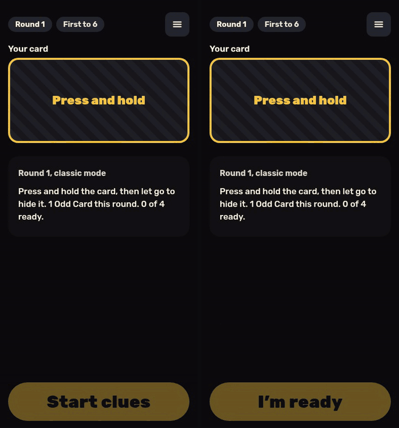

# The Odd Card

A social word game for 4 to 12 players in the same room. Everyone gets the same secret word except the Odd Card, who only sees the category and has to bluff through a round of one-word clues. Play on one phone passed around the table, or on everyone's own phone with a room code.

**Play it: [oddcard.hatethespurs.com](https://oddcard.hatethespurs.com)**
[](https://oddcard.hatethespurs.com)


<p align="center">
  
</p>

## Features

- **Two ways to play.** Pass the Phone runs the whole game on one device and works offline. Phones mode gives each player their own device, joined by a 6-letter room code, a link or a QR code.
- **Private by design.** The server sends each phone only its own card. No device ever receives another player's word or role.
- **Press-and-hold reveal.** Hold the card to see your word, let go to hide it. Word Holders and the Odd Card see the same animation and vibration, so nothing gives a role away.
- **Two modes.** Classic, where the Host judges the Odd Card's guess. Grid, where everyone sees 16 words from the category and the accused Odd Card taps a guess.
- **Mixed tables.** Players without a phone can take a seat on the Host's phone. The Host can remove players, end the game, and take the room back after losing their phone's seat.
- **Content and rules.** Six presets, saved custom presets, 204 words in 12 categories, and a searchable rules FAQ.
- **Phone-friendly.** Installs as a PWA, keeps the screen on during a game, respects safe areas and `prefers-reduced-motion`.

## Stack

- JavaScript (ES modules), no framework, no build step, no runtime dependencies.
- Cloudflare Workers, Workers Static Assets for the client.
- Durable Objects (SQLite-backed, WebSocket Hibernation API), one per room.
- Service worker and web app manifest for offline play and install.
- `node:test` for unit tests, Playwright with Chromium for multi-phone browser tests.

## Run locally

Requires Node 20 or later.

```sh
npm ci
npm run dev    # wrangler dev --local, no Cloudflare login needed
```

Open http://localhost:8787. Phones mode needs the Worker, so use `npm run dev` rather than a static server. Open more browser windows to play with several "phones".

## Tests

```sh
npm test       # 159 unit tests with node:test
npm run e2e    # multi-phone browser test in Chromium
```

The unit tests cover the game engine, the room reducer (including that no player's view contains another player's card), 180 simulated full games across every table size and both modes, the FAQ, presets, deep links, and gates for copy, motion and safe areas.

The browser tests in `test/e2e/` start `wrangler dev --local` and drive several phones at once. They need `playwright-core` (not in `package.json`) and a system Chrome. Set `PW` to the `playwright-core` directory and `CHROME` to the browser binary if they are not in the default locations. Set `BASE=https://...` for a read-only smoke test against a deployed site.

## Project structure

```
public/
  index.html         app shell
  js/engine.js       pure game logic: createGame, apply(state, action), scoring, undo
  js/room.js         pure room reducer for Phones mode, plus each player's view
  js/app.js          Pass the Phone UI, settings, wake lock
  js/phones.js       Phones mode client: join flow, WebSocket, screens
  js/words.js        word list by category
  sw.js              offline cache
src/worker.js        Worker routes and the Room Durable Object
test/                unit tests (node:test)
test/e2e/            multi-phone browser tests
wrangler.jsonc       Worker, assets and Durable Object config
```

Each room is one Durable Object. It runs every message through the pure reducer in `room.js`, saves the state, and sends each socket a view that holds only that player's secret. Pass the Phone uses `engine.js` directly in the browser and saves to `localStorage`, so it never touches the server.

## Deploying

`npm run deploy` runs `wrangler deploy` for the Worker `odd-reveal`. Run `npm test` first. See [docs/deploying.md](docs/deploying.md) for bindings and the Durable Object migration.

## More screenshots

<p>
  
  
  
</p>

## Credits

- Font: [Rubik](https://github.com/googlefonts/rubik), bundled in `public/fonts/` under the SIL Open Font License 1.1 ([license](public/fonts/LICENSE-rubik.txt)).
- Card art is original inline SVG in `public/js/art.js`.
