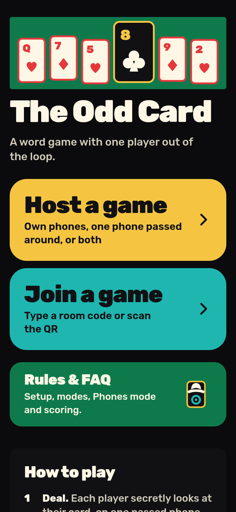
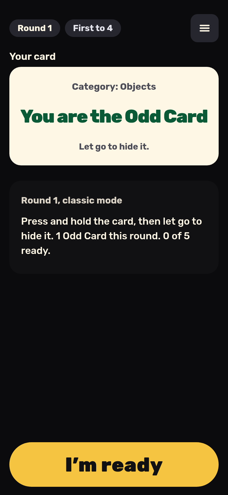
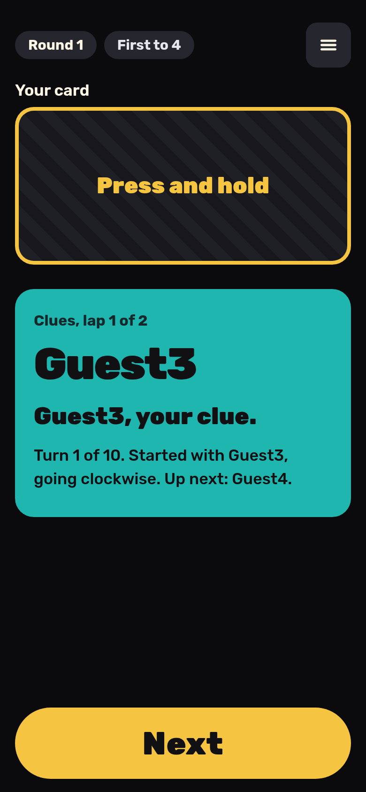

# The Odd Card

The Odd Card is a social word game for 4 to 12 players in the same room. Everyone gets a secret word except the Odd Card, who only sees the category and has to bluff through a round of one-word clues. Play on one phone passed around the table, or on everyone's own phone with a room code. On the engineering side, a Cloudflare Durable Object holds each room's state and sends every phone its own view, so no device ever receives another player's card. The app installs as an offline PWA, and both the game engine and the room reducer are pure functions covered by unit tests and simulated games.

**Live:** https://oddcard.hatethespurs.com

<p>
  
  
  
</p>

## Features

- **Two ways to play.** Pass the Phone runs the whole game on one device with no network calls after the first load. Phones mode gives each player their own device, joined by a 6-letter room code, a join link or a QR code.
- **Press-and-hold reveal.** Hold the card to see your word and let go to hide it. Word Holders and the Odd Card see the same animation and vibration, so nothing gives a role away.
- **Two modes.** Classic, where the Host judges the Odd Card's guess. Grid, where a 4×4 grid of 16 words from the category is shown to everyone and the accused Odd Card taps their guess.
- **Mixed tables.** In Phones mode, players without a phone can take a local seat on the Host's phone. The Host can remove players, end the game, and take the room back after losing their phone's seat.
- **Scoring and rounds.** One Odd Card for 4–7 players and two for 8–12. Voting, guessing and scoring follow the same rules in both ways to play. First to the target score (4–10) wins.
- **Presets and content.** Six built-in presets, saved custom presets, 204 words in 12 categories, and a searchable rules FAQ. Deep links such as `#/rules` and `#/join/CODE` open their page directly.
- **Phone-friendly.** Screen Wake Lock during a game, reveal vibration where supported, safe-area padding, `prefers-reduced-motion` support, and settings to turn animations, vibration and Keep Screen On off.

## Stack

- **Language:** JavaScript (ES modules), no TypeScript build step.
- **Server:** Cloudflare Workers, with Durable Objects (SQLite-backed, WebSocket Hibernation API) for rooms and Workers Static Assets for the client.
- **Client:** vanilla JS, HTML and CSS with no framework and no runtime dependencies. Includes a QR encoder written from scratch and inline SVG art.
- **PWA:** web app manifest plus a service worker that precaches every public file under a content-hashed cache version.
- **Tooling:** Wrangler for dev and deploy, esbuild for an optional single-file build, `node:test` for tests, and Playwright with Chromium for browser tests.

## How it works

```
public/js/engine.js   pure game logic: createGame(settings), apply(state, action), scoring, undo
public/js/room.js     pure room reducer for Phones mode, plus the per-player view projection
public/js/app.js      UI for Pass the Phone, settings, wake lock
public/js/phones.js   Phones client: join flow, WebSocket, screens
public/sw.js          offline cache
src/worker.js         Worker routes and the Room Durable Object
```

- `POST /api/create` makes a room. `GET /api/room/:code` checks that it exists. `/ws/:code` opens the room's WebSocket.
- Each room is one Durable Object. It runs messages through the reducer in `room.js`, saves state, and broadcasts a separate view to each socket. A view carries only that player's own secret.
- Sockets use the hibernation API, so a room can sleep between messages without dropping its connections. An alarm deletes each room after 12 hours.
- Pass the Phone uses `engine.js` directly in the browser and saves to `localStorage`. It never touches the server.
- `src/ask.js` is a server-only "ask a rule" endpoint that answers from the FAQ text with keyword retrieval and Workers AI. It ships turned off (`AI_MODE: "dark"`) and has no UI yet.

## Run locally

Requires Node 20 or later.

```sh
npm ci
npm run dev    # wrangler dev --local, no Cloudflare login needed
```

Open http://localhost:8787. Phones mode needs the Worker, so use `npm run dev` rather than a plain static server. To try it with several devices, open the same URL in more browser windows.

## Tests

```sh
npm test       # 159 unit tests with node:test
npm run e2e    # multi-phone browser test in Chromium
```

The unit suite covers the game engine, the room reducer (including that no player's view ever contains another player's card), 180 simulated full games across every table size and both modes, the FAQ, presets, deep links, and gates for copy, motion, corner radius and safe areas.

The browser tests in `test/e2e/` start `wrangler dev --local` on a free port and drive several phones at once. They use `playwright-core` and a system Chrome. Set `PW` to the `playwright-core` package path and `CHROME` to the browser binary if they are not in the default locations. Set `BASE=https://...` to run a read-only smoke test against a deployed site. The other e2e files (`back-nav`, `deep-links`, `host-reclaim`) run the same way with `node test/e2e/<name>.e2e.mjs`.

## Deploying

`npm run deploy` runs `wrangler deploy` for the Worker `odd-reveal`. It needs `wrangler login`, or `CLOUDFLARE_API_TOKEN` and `CLOUDFLARE_ACCOUNT_ID` in the environment. There is no CI workflow. Run `npm test` first. See [docs/deploying.md](docs/deploying.md) for bindings, the Durable Object migration and other notes.

## Credits

- Font: [Rubik](https://github.com/googlefonts/rubik), bundled in `public/fonts/` under the SIL Open Font License 1.1 ([license](public/fonts/LICENSE-rubik.txt)).
- Card art is original inline SVG in `public/js/art.js`.
